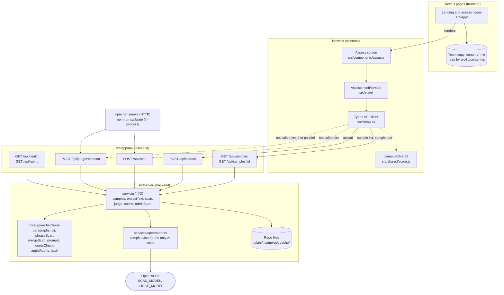
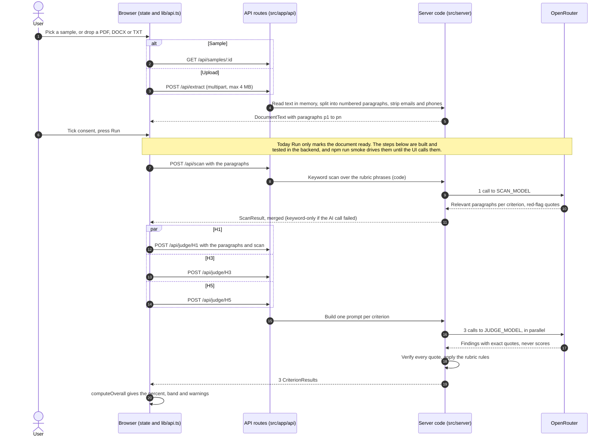
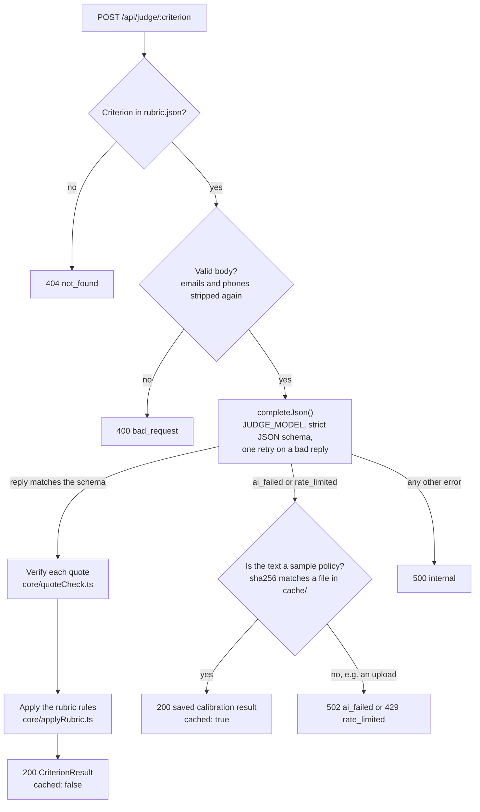

# How the pipeline works

These diagrams show what runs in the browser (frontend) and what runs on the server (backend).
They are accurate as of `main` at stage 08 (7fa4594), plus the rubric-as-config test from stage 09.

**Legend:** a solid arrow is wired and used today. A dashed arrow is built and tested in the
backend, but the UI doesn't call it yet. Until it does, `npm run smoke` (over HTTP) and
`npm run calibrate` (in-process) drive those steps.

## 1. Frontend and backend

| Runs in | What | Owner | Files |
| --- | --- | --- | --- |
| Browser | Assess screen, assessment state, typed API client, overall score | Tech A (score math: Tech B) | `src/components/`, `src/state/`, `src/lib/api.ts`, `src/shared/score.ts` |
| Next.js server, pages | Landing and assess pages, team copy | Tech A (copy: the team) | `src/app/**/page.tsx`, `src/app/layout.tsx`, `src/lib/content.ts`, `content/` |
| Next.js server, API | Thin route handlers: parse, call `src/server/`, respond | Tech B | `src/app/api/**/route.ts` |
| Server only | Extraction, scan, judge, quote check, scoring, cache, AI client | Tech B | `src/server/` |
| Repo files | Rubric, sample policies, cached runs | Tech B and the team | `rubric/`, `samples/`, `cache/` |
| External | The AI models | | OpenRouter |

## 2. One assessment, step by step

## 3. Inside one judge call, with the cached fallback

Code, not the model, decides every score. A check counts only with a verified quote. A verified
red flag sets the criterion to 0. H1 = 0 or H3 = 0 raises a baseline warning. See the
[README](../README.md#creative-use-of-technology-criterion-4) for the rules.
